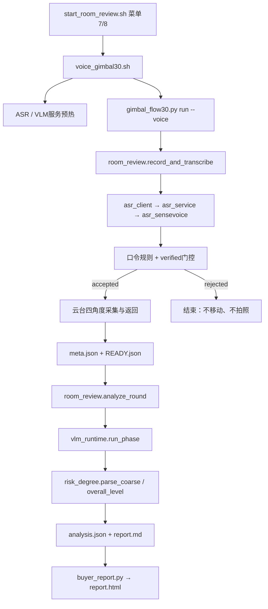

# K1 主程序开发文档

## 有效代码核对

整理基线为 GitHub 提交 `2980272`，包含前一轮六项审查修复。
另核对了原项目本地 2026-11-08 记录：最新有效轮次记为 `round_20261108_173625_edba7d`，
入口是 `scripts/board/voice_gimbal30.sh`，现场语音“可以开始了”，四张采集后分析。
该记录报告采集/返回段 30.073 秒、4/4、整体“中”；这里只引用其入口和时序，未重复做硬件实测。
原目录的未提交音频回退调整未擅自合入本次结构整理，保留在原目录。

## 调用关系



`room_review.py` 管理拍照、轮次清单、锁、ASR 门控、分析状态和机器报告；
`asr_client.py` 启动/连接 Unix socket 常驻服务；`asr_service.py` 加载识别器；
`asr_sensevoice.py` 完成 WAV→fbank→LFR→ONNX→CTC 解码。
`photo_pipeline.py` 提供图像质量代理检查，当前分析把它记录为 advisory，不把代理值当成视觉准确率。

## 入口与状态

菜单 1/2 为单张/人工换方向辅助路径，3/5 为单张语音辅助路径，4 处理 READY 轮次，
7/8 为正式四角度入口，9 为显式恢复操作。旧菜单 6 扫描入口已从正式菜单移出。

`record_and_transcribe()` 保存 `command.json`；口令拒绝不发布采集轮次。
采集保存 raw/正式图与 SHA256，只有图片保存完才发布 READY。
`analyze_round()` 验证 READY 图片路径、编号和摘要，然后按视图逐张调用视觉模型。
`analysis.json` 已存在时返回已提交结果，不自动覆盖重算。
watcher 遇错误会留 `analysis_error.json`，不无限重试；恢复需先核对日志与轮次事实再人工处理。

锁文件 `.camera.lock` 覆盖起始姿态读取、采集、异常返回；竞争失败不读写电机。
`.inference.lock` 防止语音/视觉任务互相抢占同一组资源。

## 组装和部署

```bash
python 代码包/管理代码包.py build
cd dist/运行目录
python scripts/pc/deploy_room_review.py --host k1.local
```

上述命令仅部署代码；系统依赖、模型、运行时需要在板端准备。

```bash
cd /home/biandu/rv/room_review
python3 -m pip install --break-system-packages --user -r requirements-board.txt
sudo apt install python3-spacemit-ort
python3 scripts/board/new_board_bringup.py install --only dirs,runtime,models,cues
python3 scripts/board/new_board_bringup.py verify
```

部署器会同时上传依赖清单，避免空目录部署后缺清单。
录音依赖 `arecord`，拍照依赖 `v4l2-ctl`，音频播放依赖 `pactl/pw-play` 或 ALSA；
完整系统恢复可使用离线包或按 bringup 步骤安装系统组件。详见运行说明和 PC 工具文档。

## 测试与限制

主程序对应 `test_asr_sensevoice`、`test_room_review`、`test_cues`、
`test_photo_pipeline`、`test_risk_degree_reporting`。跨模块回归另放 PC 工具模块。
测试覆盖格式、门控、失败不能当低等级、轮次状态和图片处理；不替代真人 ASR、实际画面语义、
USB 稳定性、耗时或系统内存验收。
